  <!-- Sobre mim -->
  <picture>
    <source media="(prefers-color-scheme: dark)" srcset="https://raw.githubusercontent.com/joao-hribeiro/joao-hribeiro/cards/about-dark.svg">
    
  </picture>
  <!-- Semanal -->
  <picture>
    <source media="(prefers-color-scheme: dark)" srcset="https://raw.githubusercontent.com/joao-hribeiro/joao-hribeiro/cards/weekly-dark.svg">
    
  </picture>

  
  <!-- Resumo -->
  <picture>
    <source media="(prefers-color-scheme: dark)" srcset="https://raw.githubusercontent.com/joao-hribeiro/joao-hribeiro/cards/summary-dark.svg">
    
  </picture>
  <!-- Linguagens -->
  <picture>
    <source media="(prefers-color-scheme: dark)" srcset="https://raw.githubusercontent.com/joao-hribeiro/joao-hribeiro/cards/languages-dark.svg">
    
  </picture>

