## João H. A. Ribeiro
Me chamo João Humberto de Aquino Ribeiro, tenho 18 anos e sou natural de Minas Gerais. Conclui o ensino médio profissionalizante em Técnico em Informática. Atualmente, estou cursando Engenharia Computacional na UFJF. Sou membro da categoria Seguidor de Linha na equipe [Rinobot](https://github.com/rinobot-team), atuando na área de Controle e Estratégia.

  <picture>
    <source media="(prefers-color-scheme: dark)" srcset="https://raw.githubusercontent.com/joao-hribeiro/joao-hribeiro/cards/summary-dark.svg">
    
  </picture>
  <picture>
    <source media="(prefers-color-scheme: dark)" srcset="https://raw.githubusercontent.com/joao-hribeiro/joao-hribeiro/cards/languages-dark.svg">
    
  </picture>

  <picture>
    <source media="(prefers-color-scheme: dark)" srcset="https://raw.githubusercontent.com/joao-hribeiro/joao-hribeiro/cards/about-dark.svg">
    
  </picture>
  <picture>
    <source media="(prefers-color-scheme: dark)" srcset="https://raw.githubusercontent.com/joao-hribeiro/joao-hribeiro/cards/weekly-dark.svg">
    
  </picture>

